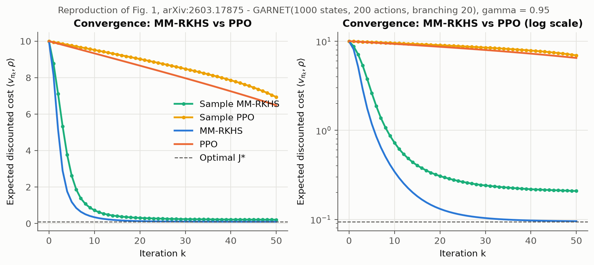
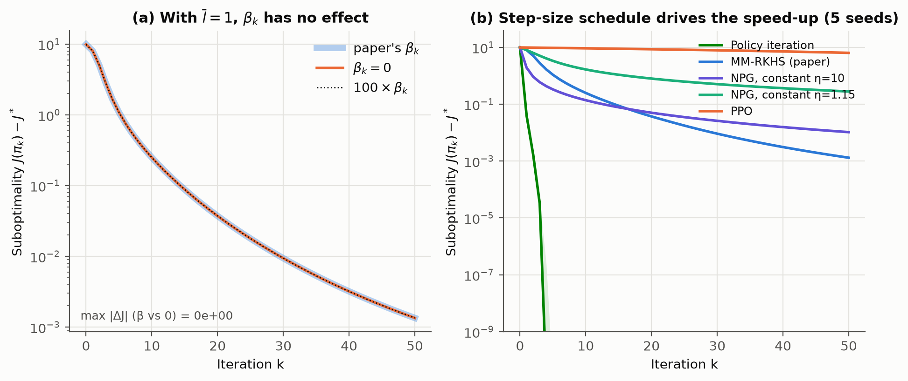
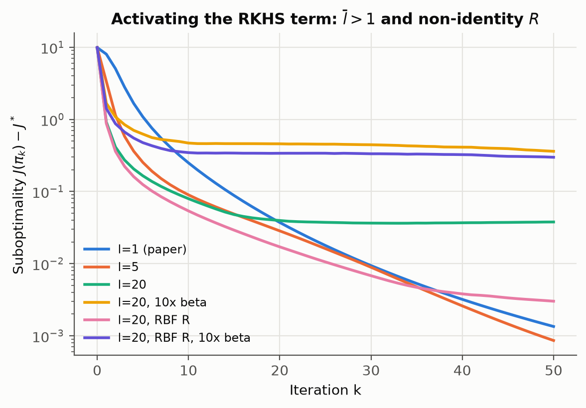

# Reproducing MM-RKHS vs PPO on GARNET

A from-scratch reproduction of the numerical experiment (Sec. 6.5, Fig. 1) in

> A. Gupta and A. Mahajan, *Operator-Theoretic Foundations and Policy Gradient Methods
> for General MDPs with Unbounded Costs*, arXiv:2603.17875v3, 2026.

plus ablations that ask **which part of MM-RKHS produces its speed-up over PPO**.
Everything is NumPy/SciPy on a laptop CPU with exact policy evaluation, so every curve
is deterministic, and the runs do not depend on hyperparameter luck.

## TL;DR

| | Result |
|---|---|
| **Reproduction** | Same picture as the paper's Fig. 1. Closed-form PPO reaches J = **6.48** after 50 iterations (paper: ≈ 6.5); MM-RKHS reaches **0.0954**, close to J\* = 0.0940. |
| **Observation 1** | With the paper's settings (l̄ = 1, p₀ = π_k), the RKHS/MMD term in eq. (6.4) is **identically zero**: `R_aᵀ(π_k(s) − p₀) = 0`. MM-RKHS then reduces to policy mirror descent / NPG, π_{k+1} ∝ π_k·exp(−η_k A), with η_k = 1.15(k+1). Setting β_k = 0 or 100·β_k changes **nothing** (max \|ΔJ\| = 0, bit-identical policies). |
| **Observation 2** | The gap to PPO comes from the step-size schedule and the mirror-descent geometry. Over 5 GARNET seeds, NPG with a *constant* η = 10 beats MM-RKHS for the first ~15 iterations. Policy iteration (the η → ∞ limit) reaches J\* in **3** iterations. |
| **Observation 3** | When the RKHS term *is* active (l̄ > 1), the outcome depends strongly on β and R. l̄ = 5 slightly improves on l̄ = 1 (final gap 8.6e-4 vs 1.3e-3). l̄ = 20 with R = I stalls at gap ≈ 0.04. An action-similarity RBF kernel for R removes most of that stall. A structured R matters, as the paper suggests, but nobody has tested it yet. |
| **Observation 4** | The paper's PPO curve matches PPO **without** visitation weighting (per-state surrogate). With the d_π-weighted surrogate in (6.1a) and lr = 0.8, PPO barely moves (9.99 → 9.99). |







## Setup (as in Sec. 6.5)

| | |
|---|---|
| MDP | GARNET: 1000 states, 200 actions, branching factor 20, γ = 0.95, ρ uniform |
| Transitions | b = 20 distinct next states per (s, a); probabilities from a random partition of [0, 1] |
| Costs | c(s, a) ~ U[0, 1] i.i.d. *(not specified in the paper — our assumption)* |
| Initial policy | uniform |
| MM-RKHS | R = I, β_k(s) = ‖A(s,·)‖_∞ / √(k+1), η_k = 1.15(k+1), l̄ = 1; sample-based variant clips ϑ to [−1.5, 1.5] |
| PPO | ε = 0.2, lr = 0.8, 10 gradient steps per iteration, tabular softmax, clipped surrogate (6.1) for cost minimisation |
| Sample-based | 5 episodes × 50,000 steps per iteration, every-visit Monte-Carlo advantages (Sutton & Barto §5.2) |
| Evaluation | J(π_k) = ⟨v_{π_k}, ρ⟩ computed **exactly** for every curve (linear solve), J\* by value iteration |

## Results

**Fig. 1 reproduction (seed 0, J\* = 0.0940)**

| Method | J₁ | J₁₀ | J₂₀ | J₅₀ |
|---|---|---|---|---|
| MM-RKHS | 8.126 | 0.343 | 0.131 | 0.0954 |
| Sample MM-RKHS | 8.775 | 0.725 | 0.306 | 0.208 |
| PPO | 9.929 | 9.330 | 8.656 | 6.484 |
| Sample PPO | 9.948 | 9.517 | 9.019 | 6.931 |
| PPO, d_π-weighted surrogate | 9.995 | 9.995 | 9.994 | 9.992 |

The closed-form curves match the paper closely. The sample-based curves have the same
shape but different end points (paper: Sample MM-RKHS ≈ 0.6, Sample PPO ≈ 8.6). The
cost distribution and the exact advantage estimator are unspecified, and both affect
those numbers.

**Where the speed comes from (5 seeds, median suboptimality J − J\*)**

| Method | k = 10 | k = 50 |
|---|---|---|
| Policy iteration | 1.8e-11 (reaches J\* at k = 3) | 1.8e-11 |
| MM-RKHS (paper settings) | 2.5e-1 | 1.3e-3 |
| NPG, constant η = 10 | 1.4e-1 | 1.0e-2 |
| NPG, constant η = 1.15 | 1.7e+0 | 2.8e-1 |
| PPO | 9.2e+0 | 6.4e+0 |

The paper says MM-RKHS converges "at a superlinear convergence rate". In these runs the
per-iteration contraction (J_{k+1} − J\*)/(J_k − J\*) *increases* from 0.55 (step 2→3) to
0.88 (step 28→29) on seed 0, so convergence slows down over time rather than speeding up.

**Activating the RKHS term (seed 0, J₅₀ − J\*)**

| Variant | J₁ | J₅₀ − J\* |
|---|---|---|
| l̄ = 1 (paper) | 8.13 | 1.3e-3 |
| l̄ = 5 | 3.46 | 8.6e-4 |
| l̄ = 20 | 1.01 | 3.8e-2 |
| l̄ = 20, 10× β | 1.77 | 3.6e-1 |
| l̄ = 20, RBF R | 0.97 | 3.0e-3 |
| l̄ = 20, RBF R, 10× β | 1.51 | 3.0e-1 |

RBF R: `R_ab = exp(−‖c(·,a) − c(·,b)‖² / h²)` with h² set to the median squared distance, plus 1e-6·I.

## Open questions

1. Is l̄ = 1 the setting used for Fig. 1? If so, the figure measures mirror descent with
   growing steps, and the IPM/RKHS majorization term never affects it.
2. Which PPO surrogate weighting produced the PPO curve: per-state or d_π-weighted?
3. With l̄ > 1, can R and β_k be chosen (or learned, as Sec. 6.4 suggests) so that the
   RKHS term reliably helps rather than stalls?

## Reproduce

```bash
pip install -r requirements.txt
pytest -q                          # 7 tests, ~2 s (incl. the l=1 reduction and a PPO gradient check)
python experiments/run_all.py      # ~30 min on an i7-12700H; writes results/*.json
python experiments/make_figures.py # writes figures/*.png
```

Run a single experiment with `python experiments/run_all.py --only fig1` (or `beta`, `inner`, `seeds`).
`results/` holds the raw curves behind every number above, plus the run log.

## Layout

```
mmrkhs/garnet.py       GARNET generator (sparse), exact evaluation, value iteration
mmrkhs/algorithms.py   MM-RKHS (6.4)-(6.5), PPO (6.1), policy iteration
mmrkhs/sampling.py     Monte-Carlo advantage estimates for the sample-based variants
mmrkhs/runner.py       run one method for K iterations
experiments/           run_all.py (experiments) and make_figures.py (plots)
tests/test_core.py     correctness checks
```

## Caveats

- These are single-environment-family results (GARNET). They don't say anything
  about MM-RKHS on general state spaces, which is the paper's main subject.
- The cost distribution, the PPO parameterisation and the advantage estimator are
  not fully specified in the paper. The choices above are documented and easy to change.
- This is an independent reproduction, not affiliated with the authors.

*Kartik Pandey, IIIT Naya Raipur, October 2026*
